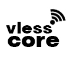

<h3><big>vless-core-app</big></h3>

`vless-core-app` is an iOS 5–14 app + root daemon for device-wide TCP routing
with VLESS, Trojan, VMess AEAD, Shadowsocks, and SOCKS5.

<br clear="left">

## Compatibility

- iOS 5.0 through iOS 14.x
- iOS 5–10 uses the ARMv7 runtime, including ARM64 devices through 32-bit compatibility
- iOS 11–14 uses a native ARM64 runtime
- Jailbreak required (rootful)

One `.deb` contains separate thin ARMv7 and ARM64 versions of the app, daemon,
core, and helper binaries. During installation, `postinst` selects ARM64 only on
iOS 11 or newer. It leaves the original ARMv7 implementation in the runtime
paths on iOS 5–10, even when the device itself has an ARM64 CPU.

See the [Issues](https://github.com/notfence/vless-core-app/issues) page for the current bug list.

## Install on iOS

### Install from official repo (recommended)

You can get this app by downloading it from my cydia/sileo repo:
```bash
https://notfence.github.io/repo/
```
### Install from latest release (.deb)

1. Download `.deb` from [latest release](https://github.com/notfence/vless-core-app/releases/latest).
2. Put the `.deb` file on your device (for example: `/var/mobile/`).
3. In iFile, find the `.deb`, tap it, and press `Install`.
4. Wait for `uicache` to finish. Respring is not required anymore.
5. As soon as you see “`Installation done! You can now exit the installer.`” you can exit the installer and start using app.

Also you can use terminal app to install it:
```bash
dpkg -i /path/to/com.vlesscore.app_iphoneos-arm.deb
```

### Install your own build via SSH (scp + dpkg)


```bash
# on build machine
scp build/com.vlesscore.app_iphoneos-arm.deb root@<idevice-ip>:/var/root/

# on iDevice
dpkg -i com.vlesscore.app_iphoneos-arm.deb
```
## Uninstall
### Uninstall via Cydia/Sileo
Just go to Cydia/Sileo and remove it like usual tweak
### Uninstall via terminal/SSH
Execute this command:
```bash 
dpkg -r com.vlesscore.app
```

## Supported configurations

The following transports apply to VLESS, Trojan, VMess AEAD, and Shadowsocks:

| Transport | No external security | TLS | REALITY |
|---|---|---|---|
| TCP / raw | ✅ | ✅ | ✅ |
| WebSocket | ✅ | ✅ | ❌ |
| gRPC gun/multi | ✅ | ✅ | ✅ |
| XHTTP | ✅ | ✅ | ✅ |
| HTTPUpgrade | ✅ | ✅ | ❌ |

> [!NOTE]
> WebSocket and HTTPUpgrade combining with REALITY is not supported by xray-core itself

SOCKS5 is supported as a separate upstream protocol, with optional
username/password authentication. It does not use this transport matrix.

- VLESS supports VLESS Encryption and applicable `xtls-rprx-vision` flows.
  These features are not available for the other protocols.
- VMess supports `alterId=0` and `auto`, `aes-128-gcm`,
  `chacha20-poly1305`, `none`, and `zero` body modes.
- Shadowsocks supports four AEAD methods and three SS 2022 methods, including
  AES SIP023 key chains. See the [CLI documentation](https://github.com/notfence/vless-core-cli#supported-configurations)
  for method names and protocol restrictions.
- Supported fingerprints: `chrome`, `firefox`, `edge`, `random`,
  `randomized`, and `qq`.
- XHTTP supports `auto`, `packet-up`, `stream-one`, and `stream-up`, XMUX,
  and a separate download channel. `auto` selects `packet-up` with none/TLS.
  With REALITY, it selects `stream-one`, or `stream-up` when a separate
  download channel is configured.
- HTTPUpgrade uses HTTP/1.1. With `ed=0` or no `ed`, it waits for
  the Upgrade response. A nonzero `ed` enables early sending.

## Import

Import links from the clipboard, files, QR codes, or manual input. Supported
sources include plain/Base64 subscriptions, HAPP, INCY links, and Karing backups.
VMess accepts address links and Base64(JSON). Shadowsocks accepts SIP002 links
and legacy fully Base64 links for ordinary AEAD. Large imports run in the
background with progress and cancellation.

## Ping

Proxy GET tests the connection through the proxy. The 5–15 second timeout applies to each attempt. Preparation and queue
waiting can increase total time. TCP and ICMP each use up to two attempts.

| Result | Meaning |
|---|---|
| DNS | Could not resolve the server's IP address. |
| TCP | Could not establish a TCP connection to the server. |
| Transport | A TLS/REALITY or transport error occurred (XHTTP, gRPC, WebSocket, or HTTPUpgrade). |
| Protocol | Failed to complete proxy protocol setup. |
| Response | Failed to receive the expected response over the connection. |
| Failed | No failure-stage details are available. |
| A number | Measured ping time in milliseconds. |

## Build

Need `vless-core-cli` first.

Build or download it from:

- Repo: https://github.com/notfence/vless-core-cli
- Latest release: https://github.com/notfence/vless-core-cli/releases/latest

`vless-core-app` package build expects these files:

- `../vless-core-cli/vless-core-darwin-armv7`
- `../vless-core-cli/vless-core-darwin-arm64`
- `../vless-core-cli/third_party/curl-ios6-armv7/bin/curl`
- `../vless-core-cli/third_party/curl-ios-arm64/bin/curl`
- `../vless-core-cli/third_party/cacert.pem`

See the [CLI build instructions](https://github.com/notfence/vless-core-cli#build)
for preparing those files and dependencies. Build the app package with:

```bash
cd /path/to/vless-core-app
IOS_TOOLCHAIN=/path/to/ios6/toolchain
APP_IOS_SDK=/path/to/iPhoneOS10.3.sdk
ARM64_IOS_SDK=/path/to/iPhoneOS11.4.sdk
make clean
make deb IOS_TOOLCHAIN="$IOS_TOOLCHAIN" APP_IOS_SDK="$APP_IOS_SDK" ARM64_IOS_SDK="$ARM64_IOS_SDK"
```

The historical `ios6` names refer to ARMv7 components targeting iOS 5.0.
ARM64 targets iOS 11.0. `make deb` rejects incompatible input binaries.

Output:

- `build/com.vlesscore.app_iphoneos-arm.deb`

Override paths if needed:

```bash
make deb \
  VLESS_CORE_BIN=/abs/path/to/vless-core-darwin-armv7 \
  VLESS_CORE_ARM64_BIN=/abs/path/to/vless-core-darwin-arm64 \
  VLESS_CORE_CURL_BIN=/abs/path/to/curl \
  VLESS_CORE_CURL_ARM64_BIN=/abs/path/to/arm64/curl \
  CA_BUNDLE=/abs/path/to/cacert.pem
```

Package uses `gzip` compression for old iOS `dpkg` compatibility.

## Runtime paths

- App: `/Applications/vless-core.app`
- Daemon API: authenticated Unix socket at `/var/run/vpnctld.sock`
- `postinst` keeps only the runtime selected for the installed iOS version and removes the other architecture
- Selected runtime: `/usr/share/vless-core/runtime-architecture`
- Core runtime path: `/usr/bin/vless-core-darwin-armv7` on iOS 5–10 or `/usr/bin/vless-core-darwin-arm64` on iOS 11+
- Subscription fetch runtime path: `/usr/bin/vless-core-curl`
- CA bundle: `/usr/share/vless-core/cacert.pem`
- Redsocks helper: `/usr/bin/redsocks-vless-core`
- Logs:
  - `/var/log/vpnctld.log`
  - `/var/log/vless-core.log`

## Full-device backend

The daemon uses `pf + redsocks` for IPv4 TCP routing on every supported version. On iOS 11–14 it
also installs a temporary, non-persistent PAC setting that sends
CFNetwork/WebKit traffic through the local SOCKS listener, including Safari
traffic that can bypass PF. Original proxy settings are restored on disconnect,
helper failure, daemon restart, package upgrade, and package removal. The PAC
state is not written to the persistent SystemConfiguration preferences.
General UDP and IPv6 routing are not supported.

## License

Code owned by notfence is available under the
[`vless-core-app Source License 1.0`](LICENSE). It may be used in personal,
internal business, and unrelated income-producing activities, but the project
itself may not be sold, included in a paid product, or used to provide a paid
VPN or proxy service. Complete, unmodified source may be redistributed;
private modification and compilation by individuals are permitted; legal
entities may use official builds but may not create private modifications.
Modified source and unofficial build artifacts may not be distributed.
Byte-for-byte identical official artifacts may be redistributed without
payment and with their notices.

## Third-party software

Third-party licenses apply only to the components identified in
[`legal/THIRD_PARTY_LICENSES.txt`](legal/THIRD_PARTY_LICENSES.txt), not to the
project as a whole. Credits shows a short dependency list and opens the full
notices, license texts, and LGPL relinking information for each component.
The `.deb` contains one combined document at:

```text
/Applications/vless-core.app/THIRD_PARTY_LICENSES.txt
```

The project license is included separately at
`/Applications/vless-core.app/LICENSE` and does not replace any third-party
license.

Corresponding ZBar source is included in this repository. redsocks is shipped
as prebuilt ARMv7 and ARM64 executables under `third_party/` and is not rebuilt
as part of the application package.
